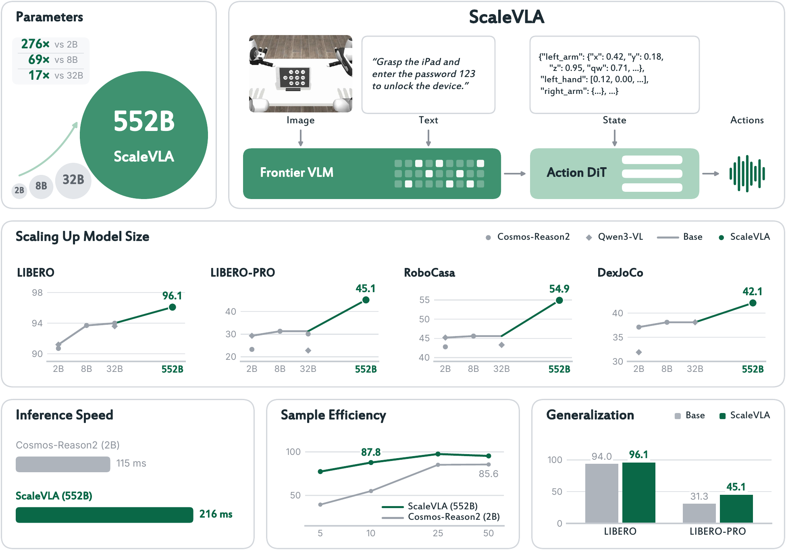
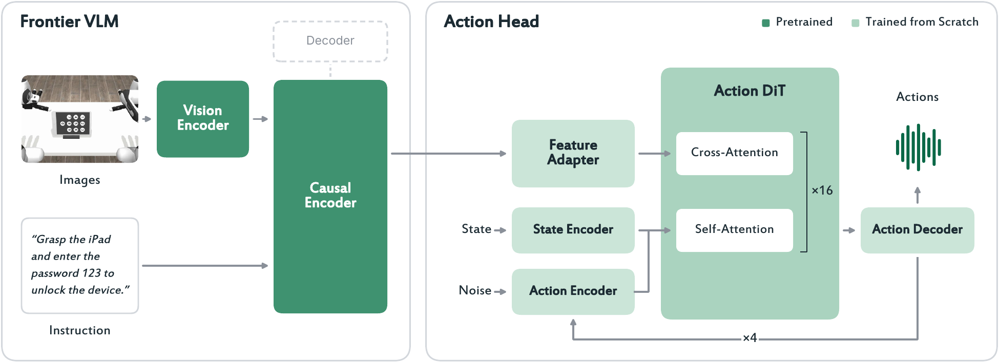

<div align="center">

# 🦾 ScaleVLA

### Scaling Vision-Language-Action Models to 552 Billion Parameters

<p align="center">
  <a href="https://galaxygeneralrobotics.github.io/scalevla/"></a>
  <a href="https://huggingface.co/deepseek-ai/DeepSeek-V4.1-Flash-1017"></a>
  <a href="LICENSE"></a>
</p>

<p align="center">
  
</p>

</div>

---

## 📖 Overview

**ScaleVLA** connects a frontier vision-language model, the 552B mixture-of-experts **DeepSeek-V4.1-Flash**, to an
action head trained from scratch. The VLM encodes the camera images and the language instruction once per action chunk,
and the action head turns these representations and the robot state into continuous actions with flow matching. This
repository contains everything needed to train and deploy a ScaleVLA policy: data preparation, feature extraction,
training, serving, and closed-loop evaluation on LIBERO, RoboCasa and DexJoCo.

<details>
<summary><b>🔬 Key Results</b></summary>

- **Sample Efficiency**: with 10 demonstrations per task, ScaleVLA outperforms a 2B backbone trained with 50 on LIBERO-Goal (87.8% vs. 85.6%).
- **Generalization**: ScaleVLA reaches 45.1% under LIBERO-PRO perturbations, compared with at most 31.3% for smaller backbones.
- **Precise Manipulation**: real-world charger insertion improves from 4/10 to 9/10 successes.
- **Efficient Inference**: 216 ms median latency per action chunk.

</details>

<p align="center">
  
</p>

### ✨ Highlights

| Feature | Description |
|---|---|
| 🧠 **Backbone** | DeepSeek-V4.1-Flash (552B MoE); its 20-layer causal encoder runs once per action chunk |
| 🦾 **Action Head** | Feature adapter, state and action encoders, 32-layer action DiT and action decoder, trained from scratch |
| 💾 **Cache-First Training** | Backbone features are extracted once and cached, so training updates only the action head |
| ⚡ **Serving** | vLLM feature server with batch-invariant kernels; served features match the training features bitwise |
| 🎮 **Benchmarks** | Data pipelines, training recipes and closed-loop evaluation for LIBERO, RoboCasa and DexJoCo |

---

## 📦 Installation

### Prerequisites

- NVIDIA GPUs; DeepSeek-V4.1-Flash runs on four GPUs with at least 141 GB each (e.g. H200)
- Python 3.12 and [uv](https://docs.astral.sh/uv/)

### Training Environment

Data preparation, training and policy serving run in the environment of [Isaac GR00T](https://github.com/NVIDIA/Isaac-GR00T):

```bash
git clone https://github.com/GalaxyGeneralRobotics/ScaleVLA.git
git clone https://github.com/NVIDIA/Isaac-GR00T.git
cd Isaac-GR00T && git checkout 944fe70 && uv sync --python 3.12 && cd ..

source Isaac-GR00T/.venv/bin/activate
cd ScaleVLA
uv pip install -e ".[train]"
```

All commands below run from the `ScaleVLA` directory.

### Backbone Environment

DeepSeek-V4.1-Flash runs on vLLM with an early-exit patch that stops the model after its causal encoder:

```bash
uv venv ../deepseek-env --python 3.12 && source ../deepseek-env/bin/activate
uv pip install vllm==0.31.0 humming-kernels==0.1.18 -e .
python -m scripts.apply_vllm_patch "$(python -c 'import site; print(site.getsitepackages()[0])')" early_exit
hf download deepseek-ai/DeepSeek-V4.1-Flash-1017 --local-dir models/DeepSeek-V4.1-Flash
export DEEPSEEK_PYTHON=$(which python)
```

### Simulators

| Benchmark | Environment |
|---|---|
| LIBERO | `bash ../Isaac-GR00T/gr00t/eval/sim/LIBERO/setup_libero.sh` |
| RoboCasa | `bash ../Isaac-GR00T/gr00t/eval/sim/robocasa/setup_RoboCasa.sh` |
| DexJoCo | install [DexJoCo](https://github.com/brave-eai/dexjoco), add `pip install pyzmq msgpack msgpack-numpy`, and set `DEXJOCO_ROOT` to its directory |

---

## 🚀 Training

### 1. Prepare Data

Download the demonstrations:

```bash
hf download IPEC-COMMUNITY/libero_goal_no_noops_1.0.0_lerobot --repo-type dataset --local-dir data/raw/libero_goal
hf download nvidia/PhysicalAI-Robotics-GR00T-X-Embodiment-Sim --repo-type dataset --include "single_panda_gripper.*" \
    --local-dir data/raw/robocasa
hf download DexJoCo/DexJoCo-Datasets-LeRobot --repo-type dataset --local-dir data/raw/dexjoco
```

Convert them into sample stores, which hold every frame, state, action and instruction once:

```bash
python -m scripts.prepare_data libero   data/raw/libero_goal data/libero_goal
python -m scripts.prepare_data robocasa data/raw/robocasa data/robocasa_gen100 --demos-per-task 100
python -m scripts.prepare_data dexjoco  data/raw/dexjoco/dexjoco_lerobot_datasets data/dexjoco_rand_obj \
    --robot-type dual_arm --configs $DEXJOCO_ROOT/configs/rand_obj
```

The other LIBERO suites are `libero_spatial`, `libero_object` and `libero_10`. For DexJoCo, the
`dexjoco_lerobot_datasets_rand_full` set with `configs/rand_full` gives the full-randomization store.

### 2. Extract Features

DeepSeek-V4.1-Flash reads every sample once; the features are stored in a feature cache.

```bash
bash scripts/run_deepseek.sh -m scripts.extract_features --model models/DeepSeek-V4.1-Flash \
    data/libero_goal data/libero_goal_features
```

Extraction resumes from completed shards. To split a large store over several nodes, run each with `--part k/n` and join
the outputs with `python -m scripts.merge_features`.

### 3. Train the Action Head

```bash
torchrun --nproc_per_node 4 -m scripts.train storage/configs/libero.yaml \
    --data.samples data/libero_goal --data.cache data/libero_goal_features --run.output_dir outputs/libero_goal
```

| Recipe | Benchmark | Action chunk | Steps | Learning rate |
|---|---|---|---|---|
| `storage/configs/libero.yaml` | LIBERO, one policy per suite | 16 | 5,000 | 1e-4, cosine |
| `storage/configs/robocasa.yaml` | RoboCasa, 24 tasks | 8 | 96,522 | 3e-5, warmup-stable-decay |
| `storage/configs/dexjoco.yaml` | DexJoCo, five bimanual tasks | 30 | 20,000 | 1e-4, cosine |

All recipes use a global batch size of 640. Any field can be overridden on the command line, e.g. `--run.steps 10000`
or `--data.demos_per_task 10`; `python -m scripts.train --help` lists every field.

---

## 🎯 Deployment & Evaluation

A feature server runs DeepSeek-V4.1-Flash, and policy servers run the trained action heads; several policy servers can share
one feature server. `scripts.check_features` confirms that the feature server reproduces the features used in training.

```bash
bash scripts/run_deepseek.sh -m scripts.serve_features --model models/DeepSeek-V4.1-Flash --port 5601 \
    --gpu-util 0.90 --max-batched-tokens 4096 &
python -m scripts.check_features --samples data/libero_goal --cache data/libero_goal_features --feature-port 5601 --out check.json
python -m scripts.serve_policy --ckpt outputs/libero_goal/checkpoint-5000 --feature-port 5601 --port 5555 &
```

Evaluate in the simulator environments:

```bash
python -m scripts.eval_libero   --suite libero_goal --episodes 50 --port 5555 --out outputs/eval/libero_goal
python -m scripts.eval_robocasa --tasks ALL --episodes 50 --ports 5555 --out outputs/eval/robocasa
python -m scripts.eval_dexjoco  --dexjoco-root $DEXJOCO_ROOT --tasks dual_arm --variant rand_obj --seeds 0,1,2 \
    --episodes 50 --ports 5555 --out outputs/eval/dexjoco
```

### 📊 Results

| Benchmark | Setting | Success (%) |
|---|---|---|
| LIBERO | Spatial / Object / Goal / Long / Average | 98.6 / 98.6 / 96.8 / 90.2 / 96.1 |
| RoboCasa | Gen-30 / Gen-100 | 30.7 / 54.9 |
| DexJoCo | Object / full randomization, five bimanual tasks | 42.1 / 24.4 |

---

## 📁 Project Structure

```
ScaleVLA/
├── 📂 scalevla/       # Core library
│   ├── backbone/      #   DeepSeek-V4.1-Flash on vLLM: engine, worker hooks, feature backbone
│   ├── data/          #   sample stores and builders, feature cache, embodiments, normalization, dataset
│   ├── features/      #   feature extraction, cache merge, feature server and client
│   ├── model/         #   feature mapper, action head, checkpoints
│   ├── training/      #   configuration, sample stream, optimizer, training loop
│   └── serving/       #   policy server and policy client
├── 📂 scripts/        # prepare_data · extract_features · merge_features · train · serve_features · check_features ·
│                      # serve_policy · eval_libero · eval_robocasa · eval_dexjoco · apply_vllm_patch · run_deepseek.sh
└── 📂 storage/        # Assets, training recipes, action-head config, RoboCasa initial states, vLLM patch
```

---

## 📚 Citation

```bibtex
@article{scalevla26,
    title  = {ScaleVLA: Scaling Vision-Language-Action Models to 552 Billion Parameters},
    author = {Yu, Ruixi and Liu, Dairu and Chen, Xuchuan and Qi, Zekun and Li, Zekai and Cao, Zhuo and
              Niu, Luyang and Zhang, Yingsheng and Liang, Sikai and Fan, Ke and Wang, He and Yi, Li},
    year   = {2026}
}
```

---

## 📄 License · Acknowledgments

Licensed under **Apache 2.0**. Built on top of [DeepSeek-V4.1-Flash](https://huggingface.co/deepseek-ai/DeepSeek-V4.1-Flash-1017),
[vLLM](https://github.com/vllm-project/vllm), [Isaac GR00T](https://github.com/NVIDIA/Isaac-GR00T),
[LIBERO](https://github.com/Lifelong-Robot-Learning/LIBERO), [RoboCasa](https://github.com/robocasa/robocasa) and
[DexJoCo](https://github.com/brave-eai/dexjoco).
